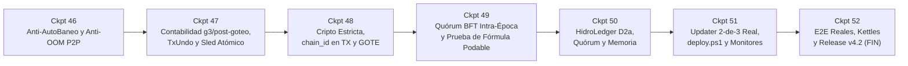

# 🗺️ Plan de Cierre y Estabilización (Checkpoints 46–52) — Ledgerita

**Fecha:** 2026-11-15  
**Base de partida:** Commit `450e95f` (Checkpoints 37–45 completados)  
**Diagnóstico origen:** [REPORTE_SESION_2026-11-15_AUDITORIA_Y_OPINION.md](file:///C:/Users/user/Documents/job/Ledgerita/handoffs/REPORTE_SESION_2026-11-15_AUDITORIA_Y_OPINION.md)  
**Brújula arquitectónica:** [inicio.md](file:///C:/Users/user/Documents/job/Ledgerita/inicio.md)  
**Próximo checkpoint pendiente:** **Checkpoint 46**

---

## 🧭 1. Cómo Evitar el "Loop Infinito" y Mantener Vivo `inicio.md`

Es normal sentir que tras cada auditoría aparecen más detalles; sin embargo, no estamos dando vueltas en círculo sino atravesando las tres etapas naturales de un protocolo real:
1. **Prototipo funcional (Ckpts 1–36):** Hacer que el libro contable, el P2P y la wallet funcionen.
2. **Arquitectura de seguridad (Ckpts 37–45):** Introducir quórum BFT, fork choice, D2a, `zeroize`, DNS y multifirma.
3. **Ajuste fino y cierre operativo (Ckpts 46–52 — ESTE PLAN):** Conectar los cables que quedaron sueltos entre las piezas nuevas y respetar las reglas originales de `inicio.md` sin convertir Ledgerita en una blockchain pesada.

### Guardrails de Fidelidad a `inicio.md` (Qué SÍ y Qué NO Hacer)

| Principio de `inicio.md` | Cómo se protege en este plan | Qué NO haremos (evitar bloat/loop) |
|---|---|---|
| **1. Cierre de Libro y Poda (~1 GB máx.)** | Mantener la poda completa en cada Cierre de Libro. Para validar transiciones entre cierres (y en época 0) sin perder la poda, usar un **diario acotado de la época actual** (`<= 4096` TXs firmadas, ~600 KB máx.) que se borra al cerrar cada época. | **NO** volver a almacenar una blockchain histórica infinita ni árboles de Merkle archivísticos pesados. |
| **2. Zero-Trust + Prueba de Fórmula + Tiempo** | Verificar cada TX matemáticamente (`verify_strict`), activar `QuorumCertificate` persistido por época y evitar auto-baneos falsos en `PeerGuard`. | **NO** exigir Proof-of-Work ni hardware dedicado ni complejas máquinas virtuales de smart contracts. |
| **3. Economía Orgánica (21M LIT + Tesoro in-hackeable)** | Corregir el cálculo post-goteo, impedir que TestNet supere 21M LIT y retirar la llave pública conocida `[0u8; 32]` del tesoro en TestNet. Proteger el goteo contra Sybils de 0 satoshis sin encarecer los micropagos reales. | **NO** imponer comisiones altas que expulsen micropagos; basta `fee >= 1 satoshi` (10⁻⁸ LIT) para participación o anti-spam. |
| **4. Nativo para IA (M2M AI-Ready) y HidroLedger** | Llevar D2a (`Transaction::new_d2`) y quórum también a `ledgerita_wallet` (HidroLedger) y asegurar `chain_id` en firmas para que agentes IA no sufran replay entre redes ni confíen en snapshots falsos. | **NO** exigir navegadores, RPCs HTTP pesados ni infraestructura cloud centralizada. |

---

## 📊 2. Mapa del Plan (Finito — Cierre en v4.2)

> **Regla de parada:** Al cerrar el **Checkpoint 52**, se da por concluida la fase de remediación de vulnerabilidades para pasar a uso operativo en TestNet/MainNet sin abrir nuevas auditorías salvo hallazgos reales en operación.

---

## ✅ 3. Checkpoints Atómicos (Listos para Retomar entre Sesiones)

### [x] Checkpoint 46 — Estabilidad P2P Urgente (Anti-AutoBaneo y Anti-OOM)
* **Ataca:** C2 (auto-baneo tras 20 TXs/votos), C3 (`RawCodec` OOM 4 GiB) y M2 (`PeerGuard::prune` + mempool sin tope).
* **Por qué primero:** Son 3 arreglos aislados de bajo riesgo que evitan que los nodos se tumben o se baneen entre sí con tráfico normal.
* **Tareas exactas:**
  1. `ledgerita_core/src/network.rs`:
     - Definir `const MAX_FRAME_BYTES: usize = 8 * 1024 * 1024;` (8 MiB) en `RawCodec::read_request` y `read_response`; rechazar `len > MAX_FRAME_BYTES` con `ErrorKind::InvalidData` **antes** de asignar `vec![0u8; len]`, y validar `len <= MAX_FRAME_BYTES` en `write_*`.
     - Enmarcar las respuestas ACK/NACK (`OK`, `DUPLICATE`, `OK_VOTE`, `INVALID_SIG`, `REJECT:...`) con formato explícito o identificar prefijos de respuesta ACK antes de `split_msg` en `Message::Response`, eliminando los falsos strikes `ChainIdSpam`.
     - Verificar `guard.is_banned(&peer, now)` al inicio de `Message::Response` (igual que en `Message::Request`).
     - Acotar `mempool` (p. ej. límite `MAX_MEMPOOL_LEN` o limpieza en cierre de época) y aplicar strike ante payloads malformados de `MSG_SYNC < 32B` o `decode_snapshot` corrupto.
  2. `ledgerita_core/src/defense.rs`:
     - En `PeerGuard::prune()`, limpiar `banned_until = None` al expirar sin borrar `ban_count` ni la reputación histórica (conservando el backoff exponencial), y purgar solo peers inactivos sin historial/baneos cuando supere un máximo de entradas en RAM.
* **Criterio de terminado:** Tests nuevos verificando rechazo de frame `> MAX_FRAME_BYTES`, 25 respuestas `MSG_TX` seguidas sin disparo de `ChainIdSpam`, y conservación de `ban_count` tras expirar un ban. `cargo test --release` 100% verde + commit.

---

### [x] Checkpoint 47 — Consenso Contable, Fork Choice y Persistencia Atómica Sled
* **Estado:** ✔ HECHO 2026-11-15 (`180 passed; 0 failed; 1 ignored` en `ledgerita_core`).
* **Ataca:** C4 (bypass `g3`), C5 (error aritmético post-goteo y `g4'`), C6 (fallos de `TxUndo`/`resolve_fork_if_divergent`) y H2 (Sled no atómico / overflows).
* **Tareas exactas:**
  1. `ledgerita_core/src/state.rs`:
     - En **Gate `g3`**: iterar `for (addr, local_nonce) in &self.nonces` verificando `remote.nonces.get(addr).copied().unwrap_or(0) >= *local_nonce` (impide resetear nonces omitiendo cuentas o enviando `nonce = 0`).
     - En **`finalize_checkpoint` (post-goteo)**: corregir `let quemado = pool - mitad;` (sin restar `carried` dos veces) y ajustar **Gate `g4'`** para que sea consistente cuando hay reparto post-goteo hacia `balances`.
     - En **`resolve_fork_if_divergent`**: ejecutar `validate_incoming_snapshot_with_quorum` **antes** de decidir `local_root < remote_root` (para sancionar snapshots inválidos aunque su hash sea mayor); si `reapplied == true` lleva a `is_checkpoint_due()`, llamar a `finalize_checkpoint()`; cuando `!reapplied`, **no** volver a encolar la TX inválida en `pending_broadcast`; en `apply_faucet` y `--mint`, limpiar `last_undo = None`.
     - En `apply_transaction`, `State::mint` y `total_supply()`: usar `checked_add` / `try_fold` para evitar overflows o panics en snapshots remotos maliciosos.
  2. `ledgerita_core/src/storage.rs` + `state.rs::flush`:
     - Reemplazar las escrituras separadas en 4 árboles por operaciones atómicas (`sled::Batch` por árbol o transacción ordenada antes de mutar disco) seguidas de `storage.flush()` explícito al cerrar escritura.
* **Criterio de terminado:** Tests unitarios cubriendo bypass de `nonce = 0`, conservación exacta `quemado + distribuido + carried == pool` en post-goteo + `g4'`, cierre de época tras `reapplied`, y roundtrip de `State::flush`. `cargo test --release` verde + commit.

---

### [x] Checkpoint 48 — Higiene Criptográfica (`verify_strict`), `chain_id` en TX y Economía GOTE M2M
* **Ataca:** H1 (Ed25519 maleable, replay MainNet↔TestNet, Sybil `0 satoshi` en GOTE, `[0u8; 32]` en TestNet) y panics en decodificación.
* **Fidelidad a `inicio.md`:** Garantiza "Prueba de Fórmula" estricta y mantiene micropagos IA de ultra-bajo costo (`MIN_FEE = 1` satoshi = $10^{-8}$ LIT, o participación GOTE solo con `fee >= 1`).
* **Tareas exactas:**
  1. `ledgerita_core/src/crypto.rs` & `release.rs`:
     - Cambiar `.verify(...)` por `.verify_strict(...)` en `Address::verify_signature`, `Address::verify_signature_with_pubkey`, `verify_manifest` y `verify_manifest_multisig`.
     - Corregir `hex_decode` (`crypto.rs`) y `unhex` (`release.rs`) usando `s.as_bytes()` y rechazando longitudes impares (sin panics en UTF-8 multibyte).
  2. `ledgerita_core/src/transaction.rs` & `serialize.rs`:
     - Añadir `chain_id` al mensaje firmado (vía helper con dominio de red / TX v4 retrocompatible en lectura o coordinado con TestNet/MainNet según compatibilidad con estado vivo — revisar en ejecución del ckpt si MainNet tiene TXs viejas almacenadas o solo snapshots).
     - En `decode_transaction`, rechazar longitudes no canónicas y bytes sobrantes al final del buffer.
  3. `ledgerita_core/src/state.rs`, `genesis.rs`, `faucet.rs`:
     - Exigir `tx.fee >= 1` (o que solo `tx.fee >= 1 && tx.amount >= 1` sume `participacion_epoch`) para impedir farming gratis del goteo sin bloquear micropagos M2M legítimos.
     - Sustituir la dirección derivada de `[0u8; 32]` en `genesis.rs` por una cuenta de reserva determinista sin clave privada trivial (respetando *"cuenta Tesoro sin clave privada, in-hackeable"* de `inicio.md`) y mantener consistente `emitido_total <= HARD_CAP_SAT` cuando haya faucet/génesis en TestNet.
* **Criterio de terminado:** Tests rechazando firmas maleables/orden-pequeño, UTF-8 inválido en `from_hex`, bytes extra en `decode_transaction`, TXs repetidas entre `Mainnet`/`Testnet` y farming GOTE con `fee = 0`. `cargo test --release` verde + commit.

---

### [x] Checkpoint 49 — Quórum BFT Intra-Época Podable + DNS Asíncrono + Respuesta `AlreadySynced`
* **Ataca:** C1 (bloqueo `g7` tras TX `4097`, pérdida de `latest_qc` al reiniciar y bypass en época 0), M1 (Riesgo 6: snapshot monolítico cada 30s) y DNS bloqueante en Tokio.
* **Fidelidad a `inicio.md`:** Aplica literalmente *Hidro-Checkpointing* + *Prueba de Fórmula*: la raíz del último Cierre de Libro viene sellada por `QuorumCertificate`, y la época abierta en curso (`<= 4096` TXs) se prueba ejecutando las TXs firmadas de la época y **se poda al cerrar época**.
* **Tareas exactas:**
  1. `ledgerita_core/src/storage.rs`, `state.rs` & `quorum.rs`:
     - Persistir `latest_qc` y `last_checkpoint_root` en `sled` (`State::flush` / `State::load`).
     - Separar en `g7` la verificación del **certificado del último Cierre** (`latest_qc` firma `(epoch, last_checkpoint_root)`) de la verificación de la época en curso mediante el **diario podable `epoch_txs`** (tope `CHECKPOINT_INTERVAL = 4096` TXs, borrado limpio en `finalize_checkpoint`): si un peer envía estado entre cierres (o en época `0`), se valida que partir de `last_checkpoint_root` (o Génesis en época 0) y aplicar `epoch_txs` (cada TX con `is_signature_valid()`) produce exactamente `remote_root`. *Elimina tanto el bloqueo al llegar a TX 4097 como el bypass en época 0 y resuelve forks multi-TX.*
     - Definir `ValidatorSet` por defecto por `NetworkId` (y `--validators-file` opcional para overrides/pruebas locales), más uso activo de `VoteCollector::prune_below` y gossip de `MSG_VOTE` en `network.rs`.
  2. `ledgerita_core/src/network.rs`:
     - Hacer `resolve_multiaddr_dns` asíncrono con `tokio::net::lookup_host` en lugar de `ToSocketAddrs` bloqueante.
     - En `MSG_SYNC`, comparar el `state_root` de 32 bytes enviado por el solicitante contra `local_root`; si coinciden, responder ACK corto `AlreadySynced` en lugar de serializar todo el snapshot cada 30s (cerrando Riesgo 6).
     - Añadir `/p2p/<PeerId>` faltante en las entradas `.64` de `FALLBACK_SEEDS_*` y conectar `default_fallback_seeds` cuando no se pase `--connect`.
* **Criterio de terminado:** Test E2E simulando cierre de época en TX `4096`, formación de `QuorumCertificate`, reinicio de nodo desde `sled`, aplicación de TX `4097` y sincronización exitosa contra un segundo nodo con quórum activo (`g7`). `cargo test --release` verde + commit.

---

### [ ] Checkpoint 50 — HidroLedger (Wallet): Fase D2a, Quórum Verificado e Higiene de Sesión
* **Ataca:** H3 (Wallet solo D1, `validator_set = None`, no resuelve `Divergent`, contraseña residente en RAM sin bloqueo).
* **Tareas exactas:**
  1. `ledgerita_wallet/src/main.rs` & `lib.rs`:
     - Soportar creación/gasto con **Fase D2a** (`Address::from_signing_key_d2` y `Transaction::new_d2`), manteniendo opción/compatibilidad de lectura para direcciones D1 existentes.
     - Agregar botón manual **"🔒 Bloquear"** y temporizador de **auto-bloqueo por inactividad** que vuelva a `Screen::Unlock` haciendo `zeroize` de `self.password`.
     - Limpiar `self.password` también en rama `Err` de `do_restaurar_respaldo` y envolver buffers temporales / `decrypt_seed` en `Zeroizing`.
     - Corregir race de `last_broadcast` / `faucet_status` y exigir `/p2p/<PeerId>` en `parse_peers`.
  2. `ledgerita_wallet/src/net_actor.rs`:
     - Pasar `ValidatorSet` de la red a `merge_if_fresher_with_quorum` (nunca `None` en red pública/TestNet oficial) para que "Confirmado por la red" signifique validación criptográfica real.
     - Conectar `resolve_fork_if_divergent` ante `SyncResult::Divergent`, arreglar el orden de `pv.synced = true` (solo tras `Ok(RemoteAdopted | AlreadySynced)`) y usar `default_seeds()` al iniciar.
* **Criterio de terminado:** `cargo test --release` en `ledgerita_wallet` (con nuevo test rechazando snapshot falso en Wallet y test de envío D2a E2E) 100% verde + commit.

---

### [ ] Checkpoint 51 — Pipeline Real de Releases 2-de-3 (`updater`), `deploy.ps1` y Monitores
* **Ataca:** H4 (`updater.rs` aún sin política 2-de-3 obligatoria, TOCTOU, ruta compartida MainNet/TestNet, `deploy.ps1`), H5 (`.gitignore` y `--data-dir` separado por red) y M2 (`monitor_tui` / `remote_monitor`).
* **Tareas exactas:**
  1. `ledgerita_core/src/bin/updater.rs`:
     - Embeber por defecto las **3 pubkeys oficiales 2-de-3** (`a3b99cd6...`, `2a733f8e...`, `fb4fc38e...` de [release_pubkeys_2of3.txt](file:///C:/Users/user/Documents/respaldos-ledgerita/release_pubkeys_2of3.txt)) como política obligatoria (`threshold >= 2`), comparando `revoked_keys` case-insensitive (`to_ascii_lowercase()`) y tolerando firmas de llaves revocadas si aún hay 2 válidas activas.
     - Eliminar TOCTOU instalando el binario desde el buffer `Vec<u8>` ya verificado en RAM (en lugar de reabrir `{dir}/release.bin` después de `cargo test`), validar `status.success()` del `cp` en `backup_proc_exe`, arreglar `--red mainnet` en `validar_guardias_manifest` y separar rutas binarias MainNet vs TestNet (`PATH_BINARIO_MAINNET` / `PATH_BINARIO_TESTNET` o parámetro de servicio).
  2. `ledgerita_core/src/main.rs`, `deploy.ps1` & `.gitignore`:
     - Separar `default_data_dir(network)` (`~/.ledgerita/mainnet` vs `testnet` manteniendo fallback si existe `~/.ledgerita` legado).
     - Actualizar [deploy.ps1](file:///C:/Users/user/Documents/job/Ledgerita/deploy.ps1): reemplazar la última IP `.61` (L203), **preservar** `--validators-file` / `--validator-id` / `--validator-key-file` en TestNet y MainNet, y preparar opción de despliegue por bundle firmado (`release_tool` + `updater`).
     - Añadir `*.seed`, `*.key`, `validators.txt`, `validator.key` a `.gitignore` (y limpiar `rustup-init.exe` si aplica).
  3. `ledgerita_core/src/bin/remote_monitor.rs` & `ledgerita_monitor_tui/src/main.rs`:
     - Evitar panic `[..18]` en `PeerId` cortos, escapar control chars en JSON y validar `g1`–`g7` / `ValidatorSet`.
     - En TUI: activar `-n`, prohibir `--refresh 0`, resolver DNS con `resolve_multiaddr_dns` y re-discar peers caídos.
* **Criterio de terminado:** Tests de `updater`, `remote_monitor` y `ledgerita_monitor_tui` en verde probando rechazo 1-de-3, revocación case-insensitive, `--red mainnet`, y `PeerId` corto + commit.

---

### [ ] Checkpoint 52 — Pruebas E2E Reales, Despliegue v4.2 en Kettles y Cierre Final
* **Ataca:** M3 (tests de integración engañosos) + despliegue operativo final.
* **Tareas exactas:**
  1. `ledgerita_core/tests/`:
     - Corregir el `NetworkId::Mainnet` vs `Testnet` mezclado en `p2p_fork.rs`, `p2p_integration.rs`, `p2p_reconnect.rs` y `p2p_stress.rs`.
     - Hacer que `p2p_fork.rs` pruebe realmente `resolve_fork_if_divergent` (Criterio A/B) sobre dos nodos en paralelo, y que `p2p_quorum_live.rs` valide también el rechazo/ban efectivo en el nodo remoto.
     - Agregar test de integración de **ciclo completo**: TXs en época 0 → cierre en 4096 con QC 2-de-3 → poda de diario → TX 4097 en época 1 → sync exitoso sin autobaneo.
  2. **Custodia física y Release v4.2:**
     - Confirmar que `release_key_2.seed` y `release_key_3.seed` (en `C:\Users\user\Documents\respaldos-ledgerita`) estén copiadas en medios separados (pendrive offline y máquina de respaldo) dejando una sola llave operativa en la PC dev.
     - Compilar binario release v4.2, firmarlo con 2 de las 3 llaves reales usando `release_tool sign` + `co-sign`, desplegar en `kettle03` (`.60`) y `kettle02` (`.64`) con `g7` activo y verificar `remote_monitor` + `updater`.
* **Criterio de terminado ("Meta Final"):** Core, Wallet y TUI 100% en verde, kettles sincronizados con v4.2 multifirma 2-de-3 + quórum intra-época verificado, `HANDOFF.md` actualizado y **fin del plan de correcciones**.

---

## 📌 4. Protocolo para Continuar si se Acaban los Tokens

Cuando retomes en una nueva sesión (o tras recargar tokens):
1. Abre este archivo o [HANDOFF.md](file:///C:/Users/user/Documents/job/Ledgerita/HANDOFF.md) y ubica el primer checkpoint con `[ ]`.
2. Envíame exactamente:  
   > *"Continuemos con el Checkpoint 46 de `handoffs/PLAN_CIERRE_Y_ESTABILIZACION_2026-11-15.md`"*
3. Cada checkpoint está dimensionado para ejecutarse, probarse (`cargo test --release`), actualizar `HANDOFF.md` + casilla `[x]` y quedar **commiteado en git** en una sola pasada limpia, sin perder contexto entre cortes.
