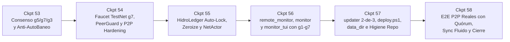

# 🗺️ Plan de Estabilización Pre-Despliegue (Checkpoints 53–58) — Ledgerita

**Fecha:** 2026-11-16  
**Base de partida:** Commit `0f521af` (Checkpoints 46–52 completados)  
**Diagnóstico origen:** [AUDITORIA_PROYECTO_2026-11-16.md](file:///C:/Users/user/Documents/job/Ledgerita/handoffs/AUDITORIA_PROYECTO_2026-11-16.md)  
**Brújula arquitectónica:** [inicio.md](file:///C:/Users/user/Documents/job/Ledgerita/inicio.md)  
**Próximo checkpoint pendiente:** **Checkpoint 55**

---

## 🧭 1. Objetivo de Esta Ronda y Fidelidad a `inicio.md`

Esta segunda ronda **no cambia la arquitectura del protocolo**: resuelve las regresiones e interacciones rotas detectadas tras activar `ValidatorSet` por defecto, Gate `g7` (`epoch_txs`), separación de rutas y framing P2P en los Checkpoints 46–52, para dejar el sistema listo para despliegue real en `kettle03` (`.60`) y `kettle02` (`.64`).

### Guardrails de Fidelidad a `inicio.md`

| Principio de `inicio.md` | Qué aseguramos en Ckpts 53–58 | Qué evitamos (cero bloat) |
|---|---|---|
| **Hidro-Checkpointing (~1 GB podado)** | Mantener poda en `sled`, acotar `PeerGuard::scores`, `seen_votes` intra-época, `VoteCollector` por época activa y `mempool` de Wallet; impedir auto-baneos en cierres de época (`4096`) o borde `epoch == 0`. | **NO** guardar historial infinito ni desactivar la poda física en `finalize_checkpoint`. |
| **Prueba de Fórmula (Zero-Trust)** | Cerrar el hueco de TX `0/0` en Gate `g5`, activar `g1`–`g7` en `monitor_tui` y `remote_monitor` con baseline real de red, y hacer que el TestNet Faucet genere transacciones verificables en `epoch_txs`. | **NO** introducir Proof-of-Work ni saltar `g7` en nodos públicos para "hacer pasar" herramientas rotas. |
| **Prueba de Tiempo + Anti-Sybil** | Conservar veteranía acumulada (`PeerGuard`) entre reinicios del SO sin perder strikes en los primeros 10 min de uptime; evictar Sybils en `prune`. | **NO** exigir listas blancas centralizadas ni bloquear nodos nuevos honestos por arrancar de cero. |
| **Tesoro in-hackeable + M2M AI-Ready** | Conservar Tesoro Génesis sin clave privada y micropagos M2M desde `1 satoshi` (`fee >= 1`); arreglar `AUTO_LOCK_SECS`, zeroización y conexión real en `HidroLedger`. | **NO** poner comisiones mínimas altas ni romper compatibilidad con D1 existente al estandarizar D2a. |

---

## 📊 2. Mapa del Plan (Finito — 6 Checkpoints hasta Despliegue Real)

---

## 📌 3. Checkpoints Atómicos (Progreso Reanudable entre Sesiones)

### [x] Checkpoint 53 — Contabilidad Zero-Trust (`g5`/`g7`/`g3`) y Anti-AutoBaneo de Consenso
* **Estado:** ✔ HECHO 2026-11-16 (`209 passed; 0 failed; 1 ignored` en `ledgerita_core`, `23 passed; 0 failed` en `ledgerita_wallet`).
* **Ataca:** Hallazgos `#5` (TX `0/0` rompe `g5`), `#7` (auto-baneo por `FaltaCertificadoQuorum`, `g3` en fork, falta de `finalize_checkpoint()` en `merge_if_fresher_with_quorum` borde `4096`, desempate léxico antes de QC, `MSG_VOTE` con `validator_set: None`), `#16` (`qc.verify` tardío en `g7`) y `#18` (`epoch == 0` sufijo parcial en `state.rs:967`).
* **Archivos principales:** `ledgerita_core/src/state.rs`, `ledgerita_core/src/network.rs`.
* **Tareas exactas:**
  1. **TX `0/0` y Gate `g5` (`state.rs`):** Rechazar en validación de TX (`apply_transaction` / verificación TX) transacciones gratuitas sin transferencia (`amount == 0 && fee == 0`) desde/hacia cuentas nuevas — o exigir `amount.saturating_add(fee) >= 1` y `fee >= 1` cuando cree cuenta inexistente — cerrando que 1 TX inserte 2 cuentas en `balances` con `0` costo y rompa `g5` (`CuentasImplausibles`). Preservar micropagos M2M válidos (`amount >= 1` o `fee >= 1`).
  2. **Orden barato y borde `epoch == 0` en `g7` (`state.rs`):**
     - En `verify_quorum_and_epoch_journal` (`epoch >= 1`), comprobar campos/tamaño esperados y verificar `qc.verify(...)` contra `remote.last_checkpoint_root` **antes** del rewind/replay costoso de hasta `4096` TXs.
     - Corregir `merge_if_fresher_with_quorum` (`epoch == 0`) para no reemplazar `self.epoch_txs` con un sufijo parcial sin conservar la cadena completa desde Génesis.
     - Llamar `finalize_checkpoint()` en `merge_if_fresher_with_quorum` cuando el estado remoto adoptado cae exactamente en `is_checkpoint_due()` (`tx_count == (epoch + 1) * CHECKPOINT_INTERVAL`).
  3. **Fork Choice y tolerancia en cierre (`state.rs` + `network.rs`):**
     - En `merge_if_fresher_with_quorum`, cuando exista discrepancia de sufijo intra-época entre dos ramas válidas que produzca `NonceRetrocedido` (`g3`) solo por tener TXs locales no presentes en la rama remota, derivar a `SyncResult::Divergent` para resolver por `resolve_fork_with_reapplied` (sin banear a peers honestos en forks normales).
     - En `resolve_fork_with_reapplied`, priorizar la rama que posea `latest_qc` BFT válido (o mayor época certificada) sobre el desempate léxico de hashes.
     - En `network.rs`, cuando un peer responda temporalmente con `GateReason::FaltaCertificadoQuorum` justo al cruzar un cierre (`epoch >= 1` con `latest_qc == None`), **no** aplicar strike inmediato de 60 min (ignorar adopción y reintentar sync; mantener ban grave inmediato ante `CertificadoQuorumInvalido`, `EmisionExcedeCap`, etc.). Si `validator_set` es `None`, no aceptar ni retransmitir `MSG_VOTE`.
* **Criterio de terminado:** Tests unitarios en `ledgerita_core` cubriendo TX `0/0` anti-`g5`, QC verificado antes de replay pesado, adopción en borde `4096` con `finalize_checkpoint()`, borde `epoch == 0` sin truncar diario, fork intra-época sin falso `g3`/ban, y no auto-ban por `FaltaCertificadoQuorum` transitorio. `cargo test --offline --release` verde + commit + marcar `[x]`.

---

### [x] Checkpoint 54 — Faucet TestNet Compatible con `g7`, `PeerGuard` Post-Reboot y Blindaje P2P/Votos
* **Estado:** ✔ HECHO 2026-11-16 (`213 passed; 0 failed; 1 ignored` en `ledgerita_core`).
* **Ataca:** Hallazgos `#6` (`--faucet` / `--mint` incompatibles con `g7` + `emitido_total`), `#9` (`PeerGuard::checked_sub` post-reboot y `prune`), `#10` (`RawCodec` pre-alloc, `connection-limits`, `InboundFailure`, `is_banned` en `ConnectionEstablished`), `#11` (`flush_pending_broadcast` / `MSG_SYNC_ALREADY`), `#12` (`seen_votes` / `VoteCollector`), `#18` (`--mint` cap/emisión) y parte de `#19` (`&hex[..16]` en `--mint`).
* **Archivos principales:** `ledgerita_core/src/faucet.rs`, `ledgerita_core/src/defense.rs`, `ledgerita_core/src/network.rs`, `ledgerita_core/src/quorum.rs`, `ledgerita_core/src/main.rs`.
* **Tareas exactas:**
  1. **Faucet TestNet y `--mint` coherentes con `g7` (`faucet.rs`, `main.rs`, `network.rs`):**
     - En `apply_faucet`: sumar `amount` a `self.emitido_total` verificando que ni `checked_total_supply() + amount` ni `emitido_total + amount` superen `HARD_CAP_SAT`.
     - En `--mint` (`main.rs`): validar `HARD_CAP_SAT`, sumar `emitido_total` y evitar slice directo `&hex[..16]` (usar helper por caracteres / `addr.to_hex()`).
     - Añadir flujo compatible con TestNet BFT (`ValidatorSet = Some`): flag `--faucet-key-file` (TX real firmada por una cuenta operadora de faucet en TestNet, añadida a `epoch_txs` y difundida por `MSG_TX`), plus soporte opcional `MSG_FAUCET` en `NetworkId::Testnet` cuando el operador arranque con `--serve-faucet --faucet-key-file` (rechazado siempre en `Mainnet`), evitando que `--faucet` sin consenso cree snapshots inaceptables por `g7` (salvo modo explícito `--validators-file` / local sin quórum).
  2. **`PeerGuard` resistente a reboots y rotación Sybil (`defense.rs`):**
     - Reemplazar `now.checked_sub(STRIKE_WINDOW).unwrap_or(now)` por comparación basada en `saturating_duration_since` (`now.duration_since(ts) <= STRIKE_WINDOW`), evitando desactivar bans durante los primeros 10 min de uptime del SO; hacer lo equivalente para veteranía y persistir edad acumulada (`antiguedad_acumulada_secs`) al importar/exportar registros para no perder "Prueba de Tiempo" tras reinicios.
     - Corregir `PeerGuard::prune`: cuando `scores.len() > MAX_PEER_SCORES`, permitir evictar entradas sin actividad reciente ni bans activos aunque tengan `primera_conexion.is_some()` (evitando fuga ilimitada ante handshakes Sybil).
  3. **Endurecimiento de socket, broadcast y votos (`network.rs`, `quorum.rs`):**
     - En `RawCodec::read_frame_with_limit`: evitar pre-asignar `vec![0u8; len]` antes de leer el stream completo (leer por bloques acotados tras validar `len <= MAX_FRAME_BYTES`).
     - Añadir `libp2p::connection_limits` en `SwarmBuilder`, comprobar `guard.is_banned` en `ConnectionEstablished` rechazando/cerrando conexión entrante o saliente si está baneado, y registrar strike ante `InboundFailure` por frame excedido/corrupto.
     - Corregir `flush_pending_broadcast`: correlacionar `OutboundRequestId` de `send_request`, no vaciar `pb` sin envío efectivo a peer no-baneado ni desde `MSG_SYNC` de monitores pasivos ni ante `MSG_SYNC_ALREADY`.
     - En `network.rs` / `quorum.rs`: acotar `seen_votes` dentro de la época vigente y evitar en `VoteCollector` que votos de `epoch + 1` expulsen entradas de la época actual (`current_epoch`). Ordenar comprobaciones baratas/caché antes de verificar Ed25519 repetidas en `MSG_TX` / `MSG_VOTE`.
* **Criterio de terminado:** Tests cubriendo `PeerGuard` con `antiguedad_acumulada_secs` / strikes con ventanas cortas y `prune` con `primera_conexion.is_some()`, `RawCodec` seguro, `VoteCollector` protegido ante flood `epoch + 1`, `flush_pending_broadcast` sin pérdida ante `MSG_SYNC_ALREADY`, y TX de Faucet TestNet validada bajo `g7`. `cargo test --offline --release` verde + commit + marcar `[x]`.

---

### [ ] Checkpoint 55 — `HidroLedger` (`ledgerita_wallet`): Auto-Bloqueo Real, Higiene RAM y NetActor
* **Ataca:** Hallazgos `#13` (`AUTO_LOCK_SECS`, `password` en claro, `decrypt_seed` sin `Zeroizing` ni check de tamaño, `mempool` sin tope, `is_banned`, `MSG_SYNC_ALREADY`, strike en snapshot corrupto) y `#17` (`resolve_fork_with_reapplied`, `use_d2` congelado, `"confirmado por la red"` sin conexión, `send_status`, `load_tx_history`, `save_contacto`, faucet compatible con `g7`).
* **Archivos principales:** `ledgerita_wallet/src/main.rs`, `ledgerita_wallet/src/crypto.rs`, `ledgerita_wallet/src/net_actor.rs`, `ledgerita_wallet/src/storage.rs`.
* **Tareas exactas:**
  1. **Auto-bloqueo y secretos en RAM (`ledgerita_wallet/src/main.rs`, `crypto.rs`):**
     - En `WalletApp::ui`: programar `ctx.request_repaint_after(Duration::from_secs(1))` mientras la wallet esté desbloqueada y **evaluar si `last_activity.elapsed() >= AUTO_LOCK_SECS` ANTES** de refrescar `last_activity` ante eventos de entrada.
     - Zeroizar `self.password` inmediatamente tras completar `unlock()` (no mantener contraseña en claro durante toda la sesión; conservar llave en `Zeroizing<[u8; 32]>` o solicitar confirmación si hace falta re-desencriptar, y zeroizar buffers temporales).
     - En `crypto.rs::decrypt_seed`: retornar `Zeroizing<[u8; 32]>` y validar `plaintext.len() == 32` antes de `copy_from_slice`.
  2. **UX, almacenamiento y fork-choice en Wallet (`main.rs`, `storage.rs`, `net_actor.rs`):**
     - No congelar `use_d2` antes de recibir el primer sync; mostrar `"Confirmado por la red"` solo cuando `pv.connected && pv.synced` y resetear `pv.synced = false` en `ConnectionClosed`; corregir borrado prematuro de `send_status` frente a `last_broadcast`.
     - En `storage.rs`: ordenar `load_tx_history` cronológicamente (desempate estable) y truncar/validar etiquetas en `save_contacto` (max 192 B UTF-8 seguro) antes de guardar.
     - En `net_actor.rs`: usar `resolve_fork_with_reapplied` re-encolando TXs reaplicadas al broadcast, poner `MAX_MEMPOOL_LEN` (y limpiar al avanzar época), verificar `guard.is_banned` en `ConnectionEstablished` y `Message::Response`, manejar `MSG_SYNC_ALREADY`, anotar strike en `decode_snapshot` fallido, procesar/retransmitir `MSG_VOTE` con quórum cuando aplique, y en TestNet usar el flujo de Faucet compatible con `g7` (vía `MSG_FAUCET` al seed TestNet o mensaje explícito si no hay operador faucet disponible, sin mutar balances localmente fuera de `g7`).
* **Criterio de terminado:** Tests en `ledgerita_wallet` verificando auto-bloqueo con `last_activity` expirada, `decrypt_seed` inválido != 32B, `load_tx_history` ordenado, `save_contacto` UTF-8 seguro y manejo de `MSG_SYNC_ALREADY`/`is_banned` en `net_actor`. `cargo test --release` en `ledgerita_wallet` verde + commit + marcar `[x]`.

---

### [ ] Checkpoint 56 — Monitores Confiables (`remote_monitor`, `monitor` y `ledgerita_monitor_tui`)
* **Ataca:** Hallazgos `#3` (`remote_monitor.rs`), `#4` (`ledgerita_monitor_tui` sin gates `g1`–`g7`) y `#14` (parte de monitores: `[..18]`, `.expect()` en hilo de red, `monitor.rs` unidades/ruta).
* **Archivos principales:** `ledgerita_core/src/bin/remote_monitor.rs`, `ledgerita_core/src/bin/monitor.rs`, `ledgerita_monitor_tui/src/main.rs`.
* **Tareas exactas:**
  1. **`remote_monitor.rs`:**
     - Corregir el baseline de validación para redes activas: en lugar de comparar cualquier época con `State::new()` (`epoch = 0, emitido = 0`), usar baseline consciente de red / estado de anclaje (`--baseline-state <dir>` o anclaje por consenso al primer snapshot que supere `g7` + `ValidatorSet` oficial + invariantes absolutas de Génesis/Cap/Goteo), de forma que `g1`–`g7` validen de verdad MainNet (`epoch >= 1`) y TestNet (`genesis`) sin falsos `GoteoIncoherente`.
     - Contar correctamente peers fallidos: no sumar `healthy += 1` cuando falla un gate; si **todos** los peers dan timeout/error, reportar `"unhealthy"` y devolver exit code distinto de `0`.
     - Con `--json`, omitir banner ASCII previo en `stdout`; implementar `-n` / `--network` realmente.
  2. **`ledgerita_monitor_tui/src/main.rs`:**
     - Ejecutar validación completa `validate_incoming_snapshot_with_quorum` (`g1`–`g7` con `default_validator_set(network)`) sobre snapshots recibidos y reflejar errores de consenso/quórum en la tabla de estado.
     - Reemplazar slice `pid.to_base58()[..18]` por truncado seguro, y manejar errores del hilo de red hacia `SharedState` sin `.expect()` mudo.
  3. **`monitor.rs`:**
     - Soportar `--network` (`default_data_dir(network)`) y formatear `fee_pool` con `format_lit(...)` en lugar de satoshis crudos etiquetados como `LIT`.
* **Criterio de terminado:** Tests en `remote_monitor`, `monitor` y `ledgerita_monitor_tui` validando rechazo real de snapshots inválidos en `g1`–`g7` contra MainNet/TestNet simulados en `epoch >= 1`, salida JSON limpia sin banner, fallo explícito si 0 peers responden y truncado seguro de `PeerId`. `cargo test --offline --release` (core) y `cargo test --release` (TUI) verdes + commit + marcar `[x]`.

---

### [ ] Checkpoint 57 — Pipeline Seguro de Releases (`updater`), `deploy.ps1`, Rutas e Higiene
* **Ataca:** Hallazgos `#1`, `#2`, `#8`, `#15` y `#19`.
* **Archivos principales:** `ledgerita_core/src/bin/updater.rs`, `ledgerita_core/src/main.rs`, `deploy.ps1`, `scripts/`, `HANDOFF.md`.
* **Tareas exactas:**
  1. **`updater.rs`:**
     - Alinear rutas/nombres de binarios con `deploy.ps1` y `scripts/*.service` (un único esquema claro por red: p. ej. `ledgerita_core` / `ledgerita_core_testnet` consistente en ambos lados).
     - En `validar_guardias_manifest`: comparar `m.red` por igualdad exacta tras normalizar (`"mainnet"`, `"testnet"`, `"ambas"`), eliminando `.contains(...)`.
     - En `canario_testnet_verde`: verificar el ejecutable real del proceso activo (`/proc/<pid>/exe` o hash SHA-256 del proceso corriendo contra el manifest), no solo el archivo en disco.
     - En `cmd_apply`: prohibir `--pubkey` arbitrario en MainNet (exigir las llaves 2-de-3 embebidas); en `cmd_verify`: exigir umbral `>= 2`; usar `cargo test --release --lib --offline --locked`; ligar criptográficamente el código/artefacto verificado o aplicar el binario verificado sin discrepancia fuente/binario; resolver `backup_proc_exe` con timestamps cuando `MainPID == 0` usando la ruta configurada.
  2. **`ledgerita_core/src/main.rs`:**
     - Restringir el fallback legado `~/.ledgerita/state` en `default_data_dir(network)` solo cuando `network == NetworkId::Mainnet`.
     - Rechazar passwords vacías (`""`), zeroizar `LEDGERITA_PASSWORD` tras uso, alinear manejo de `--send` / sync inicial y validar consistencia D1/D2 en CLI.
  3. **`deploy.ps1`, `scripts/`, Git y `HANDOFF.md`:**
     - Actualizar `deploy.ps1` y `scripts/ledgerita-core*.service` para desplegar los nombres exactos de binario que espera `updater.rs`, **preservando** flags de validador (`--validators-file`, `--validator-id`, `--validator-key-file`) en unidades systemd existentes, sin corrupción de encoding.
     - Actualizar `scripts/ledgerita-backup.sh` (rutas `mainnet`/`testnet`), `scripts/ledgerita-healthcheck.sh`, retirar `rustup-init.exe` del índice Git (`git rm --cached rustup-init.exe`) manteniendo `.gitignore`, y actualizar `HANDOFF.md` eliminando encabezados/IP `.61` obsoletos.
* **Criterio de terminado:** Tests unitarios de `updater` probando rechazo de `red = "testnet-solo"` en mainnet, bloqueo de `--pubkey` custom en mainnet, verificación 2-de-3 en `cmd_verify` y `default_data_dir(Testnet)` aislado de `~/.ledgerita/state` legado. `git rm --cached rustup-init.exe` aplicado + commit + marcar `[x]`.

---

### [ ] Checkpoint 58 — E2E P2P Reales sobre `run_p2p_node_with_quorum`, Sync Fluido y Cierre Operativo
* **Ataca:** Hallazgos `#14` (tests E2E P2P) y `#16` (optimizaciones acotadas de rendimiento en sync/I/O).
* **Archivos principales:** `ledgerita_core/tests/*.rs`, `ledgerita_core/src/network.rs`, `ledgerita_core/src/state.rs`, `HANDOFF.md`.
* **Tareas exactas:**
  1. **Tests de integración P2P reales (`ledgerita_core/tests/`):**
     - Arreglar `p2p_quorum_live.rs` frente al framing de ACK del Ckpt 46.
     - Llevar `p2p_integration.rs`, `p2p_reconnect.rs`, `p2p_fork.rs`, `p2p_stress.rs` y `p2p_quorum_cycle.rs` a ejercitar `run_p2p_node_with_quorum` real (votación BFT viva 2-de-3, TX `0/0` rechazada, Faucet firmado aprobado bajo `g7`, y convergencia de fork intra-época entre nodos reales).
  2. **Pulido acotado de latencia/CPU en sync (`network.rs`, `state.rs`):**
     - Evitar bloqueos largos del hilo Tokio P2P en operaciones pesadas de I/O (`sled::flush` / `resolve_multiaddr_dns`) y verificar deduplicación rápida antes de validar firmas repetidas bajo ráfagas.
  3. **Verificación integral pre-despliegue:**
     - Correr suites completas `--release` en `ledgerita_core`, `ledgerita_wallet` y `ledgerita_monitor_tui`.
     - Actualizar `HANDOFF.md` con estado final listo para ejecutar `deploy.ps1` / `release_tool` + `updater` en `kettle03` y `kettle02`.
* **Criterio de terminado ("Listo para Despliegue"):** Todas las suites (`ledgerita_core`, `ledgerita_wallet`, `ledgerita_monitor_tui`) 100% en verde tras el último cambio, working tree limpio y `HANDOFF.md` actualizado + marcar `[x]`.

---

## 🔄 4. Protocolo para Continuar si se Acaban los Tokens

Si hay una interrupción o recarga de tokens entre sesiones:
1. Abre este archivo ([PLAN_CIERRE_Y_ESTABILIZACION_2026-11-16.md](file:///C:/Users/user/Documents/job/Ledgerita/handoffs/PLAN_CIERRE_Y_ESTABILIZACION_2026-11-16.md)) o [HANDOFF.md](file:///C:/Users/user/Documents/job/Ledgerita/HANDOFF.md) y ubica el primer checkpoint marcado `[ ]`.
2. Envía en el nuevo chat:
   > *"Continuemos con el Checkpoint XX de `handoffs/PLAN_CIERRE_Y_ESTABILIZACION_2026-11-16.md`"*
3. Cada checkpoint termina **verificado con `cargo test --release` en verde**, con su casilla marcada `[x]` y **commiteado en Git** antes de iniciar el siguiente.
