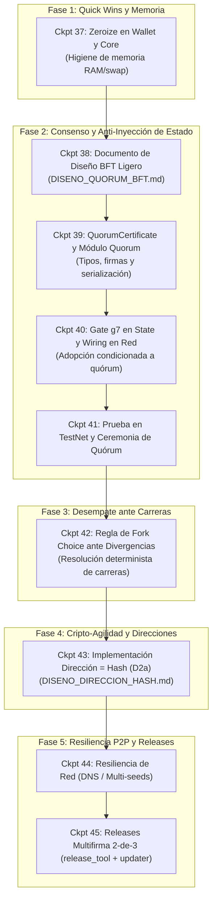

# 🗺️ Plan Maestro de Corrección de Vulnerabilidades — Ledgerita
**Fecha:** 2026-11-13  
**Estado:** Propuesta de Planificación Estructurada por Checkpoints  
**Punto de partida:** Checkpoint 36 cerrado (`8fca83e`) · Siguiente: **Checkpoint 37**  

---

## 💡 Filosofía de Ejecución: Checkpoints Atómicos

Siguiendo la metodología probada en Ledgerita (Checkpoints 1 al 36):
1. **Unidad atómica:** Cada checkpoint resuelve **un solo problema concreto**, con sus tests unitarios/integración en verde y sin romper compatibilidad.
2. **Supervivencia a cortes de tokens o energía:** Cada checkpoint terminado se:
   - Registra en el plan con su casilla marcada `[x]`.
   - Se actualiza en `HANDOFF.md` en la sección de pendientes/progreso.
   - Se commitea en git (`git commit`).
3. Si los tokens se agotan a mitad de camino, la siguiente sesión simplemente lee `HANDOFF.md` y retoma exactamente en el siguiente checkpoint pendiente sin perder un solo byte de avance.

---

## 🎯 Mapa de Ruta (Roadmap por Fases y Checkpoints)

---

## 📋 Detalle de Checkpoints

---

### 🛡️ FASE 1: Quick Wins — Higiene de Memoria y Limpieza Local

#### [x] Checkpoint 37 — Blindaje de Memoria con `zeroize` ✔ HECHO 2026-11-13
* **Vulnerabilidad mitigada:** Riesgo 7 (Exposición de contraseñas y claves privadas en memoria RAM / volcado swap de SO).
* **Implementación:**
  1. Dependencia `zeroize` 1.8 integrada en `ledgerita_core` (desde `local_deps`) y `zeroize` 1.9 en `ledgerita_wallet`.
  2. En `ledgerita_core/src/crypto.rs`: `Zeroizing` envolviendo seeds, contraseñas intermedias y buffers de desencriptado (`salt_bytes`, `ciphertext`, `pwd_bytes`). Limpieza garantizada al salir de ámbito.
  3. En `ledgerita_wallet`: `impl Drop for WalletApp` con `self.password.zeroize()`, y limpieza activa en `cambiar_red()` y tras restaurar respaldos.
  4. Tests: `test_zeroize_limpieza_memoria_activa` en core y `test_wallet_password_zeroize` en wallet. Corrección de concurrencia en tests temporales de integración (`TEST_COUNTER` atómico en `tests/helpers/mod.rs`).
* **Resultado:** Core 147 passed (110 lib + integración) · Wallet 22 passed (10 lib + 11 bin + 1 E2E). Cero warnings de memoria.

---

### 🏛️ FASE 2: Consenso Robusto — Quórum BFT Ligero (Anti-Inyección de Snapshots)

*Esta fase elimina de raíz las dos vulnerabilidades más graves de Ledgerita: la inyección de saldos arbitrarios (Vulnerabilidad 1) y la reorganización artificial por simulación rápida (Vulnerabilidad 2).*

#### [x] Checkpoint 38 — Documento de Diseño Formal (`DISENO_QUORUM_BFT.md`) ✔ HECHO 2026-11-15
* **Objetivo:** Redactar y aprobar el documento maestro de diseño antes de escribir una sola línea de código de consenso.
* **Contenido:**
  - Definición de conjunto de validadores (`ValidatorSet`): claves públicas ed25519 de los nodos de custodia (ej. `kettle03`, `kettle02` y un tercer nodo federado/comunitario).
  - Umbral de quórum: $M$ de $N$ (ej. 2 de 3 o 3 de 4).
  - Estructura del `QuorumCertificate` (QC): `epoch`, `state_root`, lista de firmas ed25519 `(validator_index, signature)`.
  - Momento de emisión: Cada Cierre de Libro (4096 TXs) genera un borrador de State Root; los validadores intercambian un mensaje ligero `MSG_VOTE` o firman el root; al reunir el quórum, el QC se adjunta al snapshot.
  - Regla constitucional: **Ningún snapshot que avance la época se adopta sin un QC válido.**

#### [x] Checkpoint 39 — Módulo `quorum.rs` y Estructura `QuorumCertificate` ✔ HECHO 2026-11-15
* **Objetivos técnicos:**
  1. Crear `ledgerita_core/src/quorum.rs`.
  2. Implementar `ValidatorSet` (anclado en génesis o configurable por red: MainNet vs TestNet).
  3. Implementar `QuorumCertificate { epoch: u64, root: [u8; 32], signatures: Vec<(u8, Signature)> }`.
  4. Función de verificación pura: `verify_qc(qc, root, validator_set) -> Result<(), QuorumError>`.
  5. Serialización binaria compacta y determinista.
  6. Tests unitarios: QC con quórum suficiente pasa, firmas falsas rechazan, validador repetido rechaza, quórum insuficiente rechaza.

#### [x] Checkpoint 40 — Gate `g7` en `state.rs` y Wiring en `network.rs` ✔ HECHO 2026-11-15
* **Objetivos técnicos:**
  1. En `state.rs`:
     - Agregar variante `GateReason::FaltaCertificadoQuorum` y `GateReason::CertificadoQuorumInvalido`.
     - En `validate_incoming_snapshot`: si el snapshot remoto avanza la época respecto al local (`remote.epoch > local.epoch`), **exigir obligatoriamente el `QuorumCertificate` válido**.
     - Actualizar snapshot a formato **v5** (incluyendo el QC opcional si `epoch > 0`).
  2. En `network.rs`:
     - Al completar un checkpoint (`finalize_checkpoint`), si el nodo es validador, firma su propio root y lo anuncia a sus peers.
     - Al recibir las firmas necesarias, consolida el QC en el estado persistido.
     - `merge_if_fresher` rechaza snapshots que intenten saltar de época sin el aval del quórum.
* **Criterio de éxito:** Un atacante que intente mandar un snapshot falso con saldo inventado es **inmediatamente rechazado por el gate g7 y baneado por 60 min por `PeerGuard`**.

#### [x] Checkpoint 41 — Despliegue en TestNet y Ensayo en Vivo de Quórum ✔ HECHO 2026-11-15
* **Objetivos técnicos:**
  1. Deploy del binario con quórum a `kettle03` y `kettle02` en TestNet.
  2. Intento deliberado de ataque: inyectar un snapshot falso desde un nodo no autorizado y verificar que los nodos de producción lo ignoran y banean al atacante.
  3. Verificación de Cierre de Libro cooperativo entre `kettle03` y `kettle02`.

---

### ⚖️ FASE 3: Desempate Determinista ante Carreras en Mempool

#### [x] Checkpoint 42 — Regla de Elección de Bifurcación (Fork Choice Rule) ✔ HECHO 2026-11-15
* **Vulnerabilidad que ataca:** Vulnerabilidad 3 (`SyncResult::Divergent` sin resolución).
* **Objetivos técnicos:**
  1. En `state.rs`, definir la regla de desempate cuando `(epoch, tx_count)` son idénticos pero `local_root != remote_root`:
     - **Criterio A:** Prevalece el State Root con menor valor numérico/léxico (`remote_root < local_root`).
     - **Criterio B (Rollback y Reintento):** El nodo perdedor retrocede la última transacción aplicada que causó la discrepancia, la regresa a su cola de pendientes (mempool), adopta el estado del ganador, y re-ejecuta la transacción con su nuevo nonce secuencial si sigue siendo válida.
  2. Implementar `rollback_last_tx()` en `state.rs` (facilitado por Sled o registros inversos).
  3. Tests de convergencia: simular dos nodos que aplican TXs contradictorias simultáneamente y comprobar que convergen a la misma raíz de forma 100% automática.

---

### 🔐 FASE 4: Cripto-Agilidad — Direcciones Hash (Fase D2a)

#### [x] Checkpoint 43 — Implementación de `Address = SHA-256(pubkey)` ✔ HECHO 2026-11-15
* **Vulnerabilidad que ataca:** Ocultar claves públicas en reposo contra cómputo cuántico futuro y preparar la red para firmas ML-DSA.
* **Documento base:** `handoffs/DISENO_DIRECCION_HASH.md` (aprobado en Ckpt 35).
* **Objetivos técnicos:**
  1. En `crypto.rs`:
     - Implementar nuevo tipo o formato de dirección derivado de `sha256(pubkey)` (32 bytes opacos).
     - La transacción v2 viaja con: `sender_address` (hash 32B), `sender_pubkey` (32B ed25519), `signature` (64B).
     - Validación en `transaction.rs`: verificar que `sha256(sender_pubkey) == sender_address` antes de chequear la firma.
  2. Fase D2a (transición suave): Los nodos aceptan direcciones legacy (D1) y direcciones hash (D2).
  3. Tests completos de roundtrip, gasto y validación.

---

### 🌐 FASE 5: Resiliencia de Red y Releases Multifirma

#### [ ] Checkpoint 44 — Resiliencia P2P y Nombres de Dominio
* **Vulnerabilidad que ataca:** Vulnerabilidad 4 (Dependencia de IP local DHCP en LAN).
* **Objetivos técnicos:**
  1. Configurar nombres de dominio dinámicos gratuitos o estáticos para los nodos semilla (ej. `seed1.ledgerita.org` o DuckDNS).
  2. En `network.rs` y `net_actor.rs`: permitir resolución DNS en las multiaddrs (`/dns4/seed.ledgerita.org/tcp/36565/p2p/...`).
  3. Lista de semillas de fallback: si la semilla principal no responde, la wallet y los clientes prueban automáticamente con la lista secundaria.

#### [ ] Checkpoint 45 — Releases Multifirma (2 de 3)
* **Vulnerabilidad que ataca:** Vulnerabilidad 5 (Punto único de falla en `release_key.seed`).
* **Objetivos técnicos:**
  1. En `release.rs` y `bin/release_tool.rs`:
     - Actualizar el formato del manifiesto para soportar múltiples firmas de release.
     - Subcomando `sign` permite agregar firmas sucesivas.
  2. En `bin/updater.rs`:
     - El pipeline de verificación (`verify_bundle`) exige al menos 2 firmas válidas de 3 claves públicas de release reconocidas.
  3. Generar las 3 llaves:
     - Llave 1: PC de desarrollo.
     - Llave 2: Almacenamiento seguro / pendrive offline.
     - Llave 3: Máquina secundaria de respaldo.

---

## 📌 Protocolo de Trabajo para Próximas Sesiones

Cuando quieras comenzar o retomar en cualquier sesión futura:
1. Revisa este archivo y localiza el **primer checkpoint pendiente con `[ ]`**.
2. Dale la instrucción al asistente:  
   *"Continuemos con el Checkpoint X del plan de corrección de vulnerabilidades"*.
3. El asistente ejecutará únicamente ese checkpoint, correrá los tests correspondientes, actualizará `HANDOFF.md`, marcará la casilla con `[x]` y commiteará en git.
4. **Cero riesgo de desorientación o pérdida de contexto**, sin importar cuántos días pasen o si los tokens se reinician.

