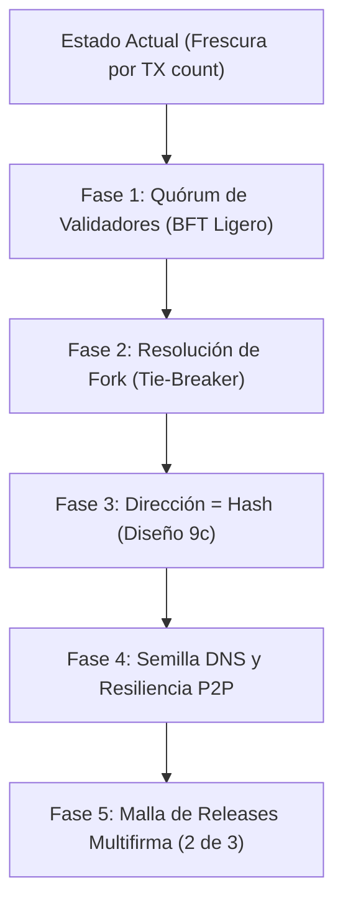

# 🛡️ Reporte de Sesión y Auditoría Técnica — Ledgerita (2026-11-13)

**Fecha y hora:** 2026-11-13 12:25 (hora local)  
**Tipo de documento:** Auditoría Integral de Seguridad, Análisis de Arquitectura y Opinión de Proyecto  
**Último commit en repo:** `8fca83e` (Cierre de sesión 2026-11-12, Ckpt 36)  
**Estado de git:** 1 archivo no versionado (`consulta10-11-2026.txt`), working tree limpio.  
**Suites de tests de referencia:** Core 146 passed · Wallet 21 passed (incluido E2E).  

---

## 🎯 Resumen Ejecutivo

A solicitud del desarrollador, se ha realizado una inspección exhaustiva de **todos los archivos** del proyecto `Ledgerita`: código fuente (`ledgerita_core`, `ledgerita_wallet`, `ledgerita_monitor_tui`), scripts de infraestructura (`deploy.ps1`, `setup-systemd.sh`, `healthcheck`), manifiestos de release, diseños (`DISENO_*.md`) e historial de sesiones (`handoffs/`).

**Veredicto General:**  
Ledgerita es un proyecto con un **nivel de ingeniería, rigor contable y documentación excepcional** para un desarrollo independiente. La evolución desde el MVP de junio de 2026 hasta la versión 4.1.0 actual (noviembre de 2026) demuestra una disciplina técnica sobresaliente: resolución matemática del bug de divergencia (GOTE), 6 gates de validación de estado (`g1`–`g6`), sistema de defensa local (`PeerGuard`), cadena de custodia de autoupdate con consentimiento humano obligatorio (`updater` F1–F3), y wallet GUI nativa (egui) con nodo P2P embebido.

Sin embargo, para dar el salto de un **entorno de laboratorio soberano / red privada** a una **red pública adversaria**, el proyecto presenta **vulnerabilidades críticas en el modelo de consenso y sincronización de estado** que deben ser abordadas.

---

## 💎 1. ¿Qué opinamos del proyecto? (Puntos Fuertes)

1. **Arquitectura Limpia y Modular:**
   - La división de responsabilidades es impecable: `crypto` (identidad y cifrado), `transaction` (modelo inmutable y firmas), `state` (máquina determinista con `BTreeMap`), `network` (actor libp2p asíncrono con `request_response` y `ping`), `defense` (reputación node-local) y `storage` (8 árboles aislados en Sled).
2. **Determinismo y Rigor Contable:**
   - Todo monto se computa en satoshis (`u64`) con comprobaciones `checked_add` y `saturating`. El suministro está anclado a 21,000,000 LIT sin inflación descontrolada.
   - La resolución de la distribución del `fee_pool` mediante el sistema **GOTE** (Checkpoint 21, quema del 100% durante la era de goteo y reparto 50/50 posterior derivado estrictamente de `participacion_epoch`) resolvió de raíz el problema de divergencia en el Cierre de Libro.
3. **Cultura de Pruebas y Verificación:**
   - Más de 167 tests automatizados en total, cubriendo caminos felices, casos negativos, intentos de manipulación de manifiestos, desbordamientos numéricos y regresiones.
4. **Cadena de Custodia en Autoupdate (F1–F3):**
   - El sistema de actualización es de los más seguros vistos en proyectos de esta escala: separación de llaves de release vs fondos, verificación SHA-256 + firma ed25519 del binario, compilación y paso de tests en el host antes del swap, backup atómico vía `/proc/<pid>/exe`, post-check de systemd, canario obligatorio en TestNet y la frase de consentimiento humano determinista (`sí, mainnet <versión> commit <commit>`).
5. **Autonomía y Resistencia:**
   - Capacidad de compilar y correr de forma local/offline (`local_deps/`), binario de wallet portable para pendrives USB (`portable.flag`), y herramientas de diagnóstico TUI y remotas.

---

## 🚨 2. Vulnerabilidades y Riesgos de Seguridad Detectados

A continuación se detallan las vulnerabilidades identificadas al auditar la interacción entre el protocolo P2P y la máquina de estado.

### 🔴 Vulnerabilidad Crítica 1: Inyección Arbitraria de Estado en `merge_if_fresher` (Falta de Prueba de Transición)

* **Ubicación:** `ledgerita_core/src/state.rs` (`merge_if_fresher`, L362–395) y `validate_incoming_snapshot` (L233–360).
* **Mecanismo:**  
  Cuando un nodo recibe un mensaje `MSG_SYNC` con un snapshot cuyo par `(epoch, tx_count)` es mayor al local, el nodo ejecuta los 6 gates aritméticos (`g1`–`g6`). Si pasan, **el nodo reemplaza inmediatamente su mapa de `balances` y `nonces` por el del remoto sin exigir ni verificar transacciones intermedias ni firmas**.
* **Escenario de Ataque:**  
  Un peer malicioso se conecta a un nodo honesto que tiene `tx_count = 4096`. El atacante construye un snapshot fraudulento con:
  - `tx_count = 4097` (más fresco).
  - Incrementa el `nonce` de la víctima en 1 (pasa `g3`).
  - Asigna el balance de la víctima a `0` y se lo adjudica a su propia dirección (el `supply` total se mantiene idéntico, pasando `g1`).
  - Mantiene los fees y la emisión coherentes (pasan `g4'` y `g6`).
  - Registra 1 cuenta nueva (pasa `g5`).
* **Impacto:**  
  El nodo honesto adopta el snapshot. **Los fondos de la víctima son transferidos al atacante sin que la víctima haya firmado jamás una transacción**.
* **Causa Raíz:**  
  La premisa de "podar el historial y no almacenar bloques infinitos" omite la **prueba criptográfica de transición de estado**. No hay bloques encadenados, ni pruebas de conocimiento cero (ZK), ni firmas de un quórum de validadores sobre la validez del nuevo State Root.

---

### 🔴 Vulnerabilidad Crítica 2: Ataque de Reorganización por Simulación Rápida (Sin Resistencia Sybil de Consenso)

* **Ubicación:** `ledgerita_core/src/state.rs` (Criterio de frescura `(epoch, tx_count)`).
* **Mecanismo:**  
  El protocolo define que "el estado con mayor `(epoch, tx_count)` es el estado vigente de la red".
* **Escenario de Ataque:**  
  Al no existir Proof-of-Work (costo de energía/cómputo) ni Proof-of-Stake con penalizaciones (slashing) ni quórum federado (BFT):
  - Un atacante con una laptop ordinaria genera en bucle local 10,000 transacciones válidas entre 2 direcciones que él controla, pagando 1 satoshi de fee por transacción.
  - En cuestión de segundos, su nodo local alcanza `tx_count = 14,096` (Época 3).
  - Al conectarse a los nodos de producción (`kettle03` y `kettle02`, cuyo `tx_count` sea honestamente menor), los nodos de producción verán un estado con `epoch 3 > epoch 1`, que cumple matemáticamente todas las reglas.
* **Impacto:**  
  Los nodos de producción descartan su estado honesto actual y adoptan la bifurcación del atacante, borrando cualquier transacción honesta reciente de los usuarios reales.

---

### 🟡 Vulnerabilidad 3: Divergencia Irreversible ante Carreras en Mempool (Doble Gasto Concurrente)

* **Ubicación:** `ledgerita_core/src/network.rs` (L675–682) y `state.rs` (`SyncResult::Divergent`).
* **Mecanismo:**  
  Si un remitente malicioso o un usuario con dos conexiones envía simultáneamente dos transacciones válidas con el mismo `nonce` (TX_A a `kettle03` y TX_B a `kettle02`):
  - Ambos nodos aceptan y aplican una transacción distinta.
  - Ambos nodos avanzan a `tx_count = N + 1` en la misma época.
  - Al cruzar snapshots por `MSG_SYNC`, ambos tienen la misma frescura `(epoch, tx_count)` pero `state_root` diferente.
* **Impacto:**  
  El sistema detecta `SyncResult::Divergent`, emite un `warn!`, pero **no tiene implementado ningún mecanismo de desempate, rollback o elección de bifurcación (fork-choice rule)**. La red se parte en dos mitades permanentemente desincronizadas.

---

### 🟡 Vulnerabilidad 4: Dependencia Topológica y Fragilidad del Enjambre P2P

* **Ubicación:** Multiaddrs cableadas en `SECRETS_LOCAL.md` y `net_actor.rs`.
* **Mecanismo:**  
  Actualmente, la red depende críticamente de un único nodo semilla (`kettle03`) ubicado en una red LAN privada con asignación DHCP variable (`192.168.68.61` / `.51`).
* **Impacto:**  
  - No existen nodos de arranque públicos (Bootstrap nodes con IP estática o DNS dinámico).
  - No hay traversal de NAT (STUN, UPnP, AutoNAT de libp2p).
  - Si la máquina `kettle03` cambia de IP o sufre un corte eléctrico, las wallets y nodos secundarios quedan en aislamiento total sin capacidad de auto-descubrimiento.

---

### 🟡 Vulnerabilidad 5: Llave de Release como Punto Único de Falla (SPOF)

* **Ubicación:** `release_key.seed` (archivo local de 32 bytes en la máquina de desarrollo).
* **Mecanismo:**  
  La custodia del canal de autoupdate de toda la red reside en una única clave privada ed25519.
* **Impacto:**  
  Si la máquina del desarrollador sufre una intrusión (malware, troyano o exfiltración), un atacante puede firmar un binario malicioso que los nodos adoptarán tras el visto bueno humano o si compromete la sesión. A la inversa, si el archivo se corrompe o se pierde, no hay mecanismo de rotación de claves ni multifirma (M-of-N).

---

### 🟢 Riesgo 6: Sobrecarga de Ancho de Banda por Snapshot Monolítico

* **Ubicación:** `ledgerita_core/src/network.rs` (`MSG_SYNC` cada 30 segundos).
* **Mecanismo:**  
  En cada tick de resincronización (30s) y en cada conexión, el nodo envía el mapa completo de `balances` y `nonces`.
* **Impacto:**  
  Para 10 cuentas en laboratorio es instantáneo. Para 50,000 cuentas, un snapshot de ~3 MB transmitido cada 30 segundos saturará el ancho de banda y degradará el rendimiento de la CPU en deserialización.

---

### 🟢 Riesgo 7: Higiene de Memoria en la Wallet (Contraseña y Semillas sin Zeroize)

* **Ubicación:** `ledgerita_wallet/src/main.rs`, `lib.rs` y `crypto.rs`.
* **Mecanismo:**  
  La contraseña de desbloqueo y las semillas privadas se gestionan en tipos estándar de Rust (`String`, `Vec<u8>`).
* **Impacto:**  
  Al liberarse, la memoria no se sobrescribe con ceros (`zeroize`). En sistemas operativos con memoria virtual (swap en disco) o volcados de memoria por depuración, las claves privadas y contraseñas podrían quedar expuestas en texto claro en el almacenamiento secundario.

---

## 🧭 3. ¿Crees que así va bien o harías algo diferente? (Recomendaciones de Arquitectura)

### Nuestra Conclusión:
**¿Va bien? Sí, va extraordinariamente bien para el propósito que ha tenido hasta hoy:** un proyecto de investigación, aprendizaje profundo y desarrollo de una red contable soberana y ultra-ligera en Rust. La calidad del código y la velocidad de ejecución son envidiables.

**¿Está lista para producción pública abierta o uso comercial? No todavía.**  
Si abrieras la red hoy a usuarios externos o desconocidos, las vulnerabilidades 1 y 2 permitirían vaciar saldos y reorganizar la red sin costo económico.

---

### 🛠️ Lo que haríamos diferente (Plan de Evolución Recomendado)

Para mantener la esencia de Ledgerita (**ligera, sin minería intensiva de PoW, determinista**) pero cerrando las brechas de seguridad, proponemos los siguientes cambios estructurales priorizados:

#### Prioridad 1: Resolver la Inyección de Estado mediante un Quórum de Validadores (BFT Ligero)
* **Concepto:** No necesitas volver a Bitcoin ni implementar PoW.
* **Solución:** Cada Cierre de Libro (cada 4096 TXs) debe generar un State Root que debe ser **firmado por un quórum conocido de validadores (ej. 2 de 3 nodos autorizados o con Prueba de Tiempo consolidada)**.
* **Regla de Adopción:** Un snapshot solo se adopta si viene acompañado de un certificado de quórum (`QuorumCertificate` con $M$ firmas ed25519 válidas sobre el State Root). Con esto, un atacante no puede inventar balances en snapshots porque no posee las firmas del quórum.

#### Prioridad 2: Regla de Desempate ante Divergencias (Fork Choice Rule)
* **Solución:** Cuando dos nodos empatan en `(epoch, tx_count)` pero difieren en State Root, implementar una regla determinista:
  - Comparación léxica de State Roots (el menor hash prevalece temporalmente), o
  - La transacción con marca de tiempo de red más antigua y menor hash gana, revirtiendo la transacción concurrente perdedora al mempool para re-ejecución con nonce incremental.

#### Prioridad 3: Implementar la Dirección como Hash (`DISENO_DIRECCION_HASH.md` / Checkpoint 35)
* **Por qué antes de crecer:** Actualmente la dirección es la clave pública ed25519 completa (32 bytes). Al migrar a `address = SHA-256(pubkey)`, se protege a las cuentas contra ataques cuánticos retroactivos (la clave pública no se expone hasta el primer gasto) y se prepara el terreno para la firma post-cuántica ML-DSA sin romper la estructura de 32 bytes de la base contable.

#### Prioridad 4: Resiliencia de Red y Nombres de Dominio
* **Solución:**  
  - Reemplazar las IPs cableadas `192.168.68.x` por nombres de host o DNS dinámico (DuckDNS, Cloudflare o No-IP gratuito) en los nodos de producción.
  - Habilitar descubrimiento Kademlia DHT completo o soporte para NAT traversal con `libp2p::autonat`.

#### Prioridad 5: Blindaje de la Llave de Releases (Multifirma 2 de 3)
* **Solución:**  
  - En lugar de una sola `release_key.seed`, actualizar `release_tool` y `updater` para exigir un esquema 2-de-3 (ej. llave en PC dev + llave en pendrive seguro + llave en máquina offline).

#### Prioridad 6: Incorporar `zeroize` en Criptografía de Wallet
* **Solución:**  
  - Añadir el crate `zeroize` a `ledgerita_wallet` y `ledgerita_core`.
  - Envolver claves privadas, seeds y contraseñas en `Zeroizing<String>` o `Zeroizing<Vec<u8>>` para garantizar que la memoria se limpie al salir de ámbito.

---

## 🗂️ Registro y Próximos Pasos

Este informe ha sido generado para consolidar el diagnóstico técnico del proyecto al **13 de noviembre de 2026**.

* **Documento de referencia vigente:** `HANDOFF.md` permanece como la fuente de verdad operativa.
* **Sugerencia para la próxima sesión de trabajo:** Evaluar la implementación del esquema de **Firmas de Quórum en Snapshots (BFT Ligero)** o proceder con el diseño ya aprobado de **Direcciones Hash (Fase D2a)**.

*Fin del reporte de auditoría técnica.* 🛡️💎

